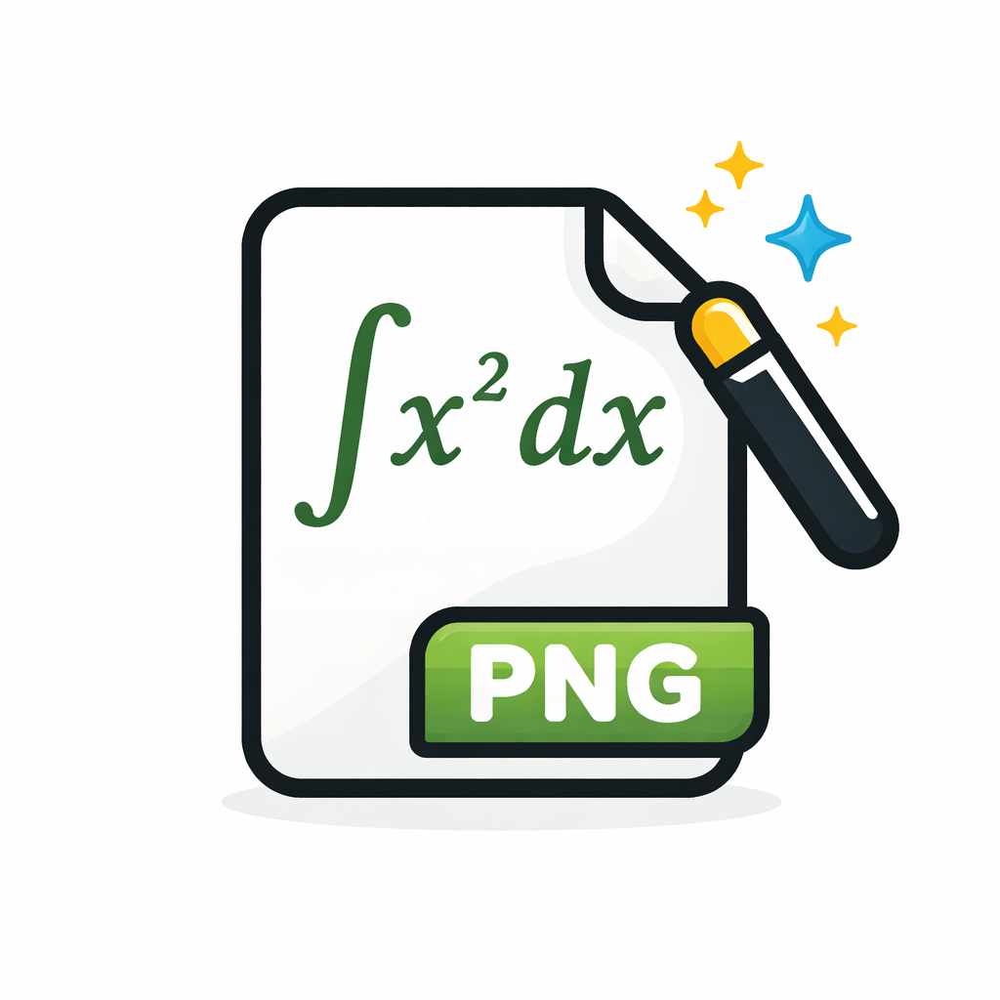
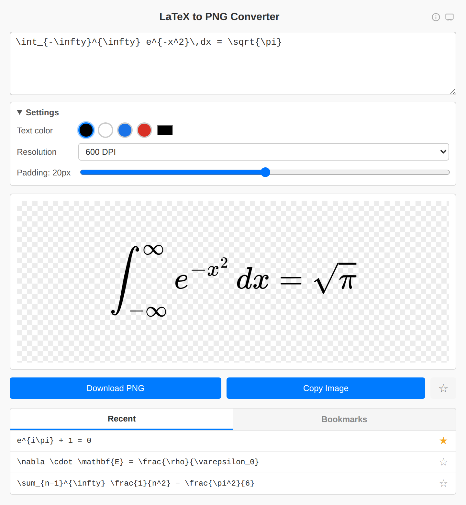
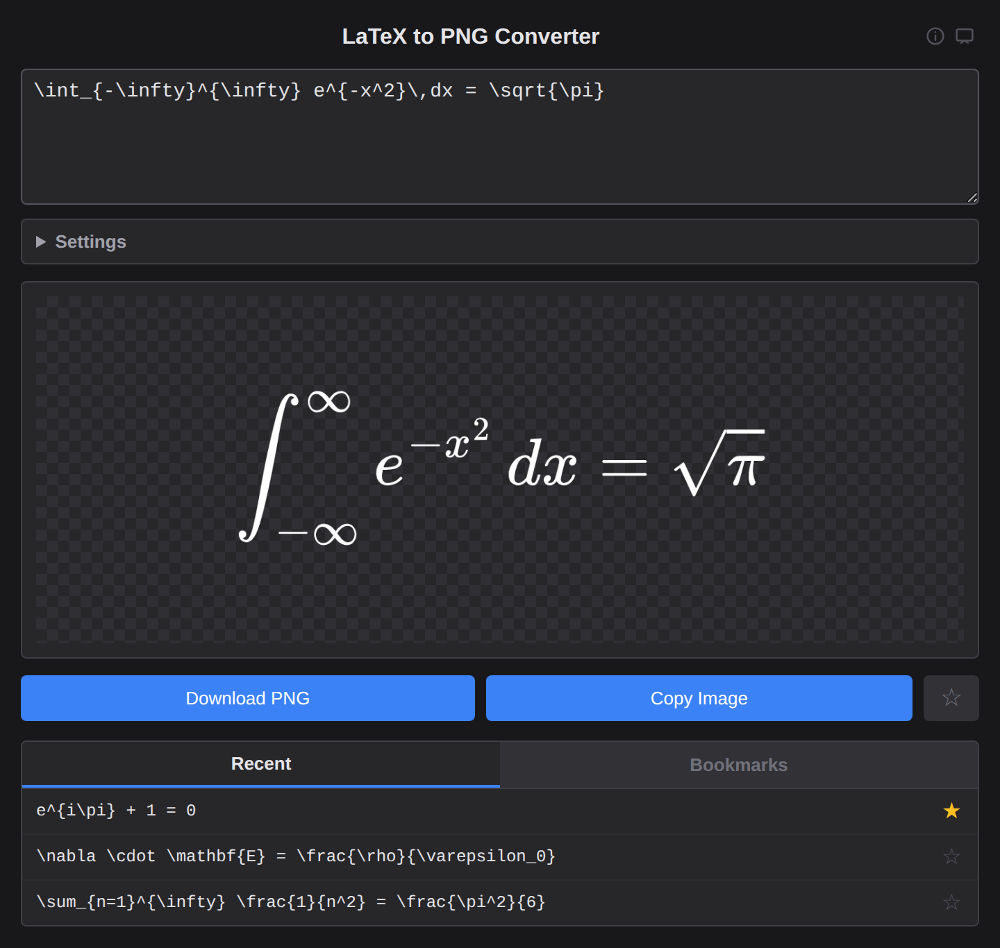
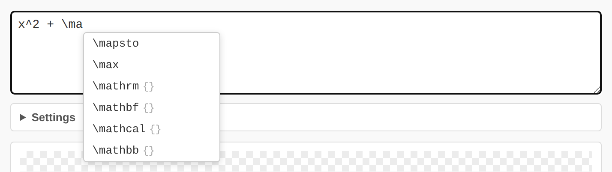

<p align="center">
  
</p>

<h1 align="center">LaTeX to PNG</h1>

<p align="center">
  A small desktop app that turns LaTeX math into high-resolution, transparent PNGs —
  ready to paste into slides, documents and notes.
</p>

<p align="center">
  <a href="https://github.com/gabrielesano/latextopng_app/releases/latest">Download</a> ·
  <a href="#features">Features</a> ·
  <a href="#build-from-source">Build from source</a>
</p>

<p align="center">
  
  
</p>

## Features

- **Live preview** while you type, rendered offline with MathJax
- **150 / 300 / 600 DPI** export with a transparent background. The DPI is stored in the PNG, so Word, PowerPoint & co. insert it at the right size
- **Text colour and padding** settings
- **Copy to clipboard** or **save as PNG**
- **Clear error messages** for invalid LaTeX (e.g. *Missing close brace*)
- **Autocomplete** for common commands, plus automatic closing of brackets and `\begin{…}` environments

  

- **History and bookmarks** for the equations you use most
- **Light, dark or system theme**, and zoom with <kbd>Ctrl</kbd> <kbd>+</kbd> / <kbd>−</kbd>

### Example output

<picture>
  <source media="(prefers-color-scheme: dark)" srcset="docs/images/example-output-white.png">
  
</picture>

```latex
f(x) = \frac{1}{\sigma\sqrt{2\pi}} \, e^{-\frac{(x-\mu)^2}{2\sigma^2}}
```

## Download

Installers for **Windows**, **macOS** (Apple Silicon and Intel) and **Linux** (`.deb`, `.rpm`, `.AppImage`) are on the [Releases page](https://github.com/gabrielesano/latextopng_app/releases/latest).

> The builds are not code-signed. Windows SmartScreen may ask you to confirm with *More info → Run anyway*.
> On macOS, if the app is reported as damaged, run `xattr -cr "/Applications/LaTeX to PNG.app"`.

## Keyboard shortcuts

| Shortcut | Action |
|---|---|
| <kbd>Ctrl</kbd> <kbd>S</kbd> | Save PNG |
| <kbd>Ctrl</kbd> <kbd>Shift</kbd> <kbd>C</kbd> | Copy image |
| <kbd>Ctrl</kbd> <kbd>B</kbd> | Toggle bookmark |
| <kbd>Ctrl</kbd> <kbd>I</kbd> | Shortcuts & info |
| <kbd>Ctrl</kbd> <kbd>+</kbd> / <kbd>−</kbd> / <kbd>0</kbd> | Zoom in / out / reset |
| <kbd>Tab</kbd> | Accept autocomplete suggestion |

On macOS use <kbd>⌘</kbd> instead of <kbd>Ctrl</kbd>.

## Build from source

Requirements: [Rust](https://rustup.rs) and the [Tauri 2 prerequisites](https://v2.tauri.app/start/prerequisites/) for your OS.

```bash
cargo install tauri-cli --version "^2" --locked

cargo tauri dev     # run in development mode
cargo tauri build   # build installers into src-tauri/target/release/bundle
```

There is no frontend build step: the UI in `ui/` is plain HTML, CSS and JavaScript.

## How it works

```
LaTeX → MathJax (SVG) → canvas at the chosen DPI → PNG + pHYs (DPI) chunk
```

Everything runs locally, and no data leaves your computer. The app is built with [Tauri 2](https://tauri.app) and [MathJax 3](https://www.mathjax.org).
